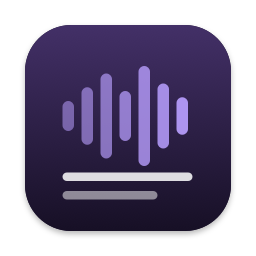
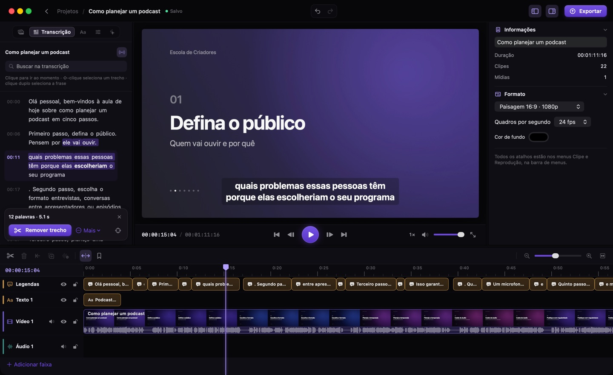

<p align="center">
  
</p>

<h1 align="center">Audra</h1>

<p align="center">
  <strong>Transcreva, resuma e edite vídeos no seu Mac.</strong><br>
  Transcrição no dispositivo, resumos com Apple Intelligence e um editor com timeline que também corta pelo texto.
</p>

<p align="center">
  <a href="https://steinertruthy.github.io/audra/">Site oficial</a> ·
  <a href="https://github.com/steinertruthy/audra/releases/latest">Download</a> ·
  <a href="CHANGELOG.md">Novidades</a> ·
  <a href="docs/development.md">Desenvolvimento</a>
</p>

<p align="center">
  
</p>

## Recursos

- **Transcrição no dispositivo** com o reconhecimento de fala do macOS, marcação de tempo por palavra e detecção de idioma com prioridade para o português do Brasil.
- **Resumos com IA**: visão geral, tópicos, pontos importantes, decisões, próximos passos e capítulos, gerados pelo Apple Intelligence no Mac. O Claude (Anthropic) é opcional e exige consentimento.
- **Editor de vídeo** com timeline de várias faixas, miniaturas, formas de onda, transições, velocidade, transformações e histórico para desfazer.
- **Edição pelo texto**: selecione palavras na transcrição para remover, silenciar ou localizar o trecho; legendas automáticas que respeitam os cortes.
- **Exportação** em MP4/MOV (H.264 ou HEVC por hardware), M4A, TXT, Markdown, SRT e PDF.
- **Privacidade**: sem contas, sem coleta de dados e com processamento local. Os arquivos originais nunca são alterados.

## Instalação

1. Baixe o `Audra.dmg` na [página de releases](https://github.com/steinertruthy/audra/releases/latest).
2. Abra o arquivo e arraste o Audra para **Aplicativos**.
3. Na primeira abertura, se o macOS bloquear o app, vá em **Ajustes do Sistema › Privacidade e Segurança** e clique em **Abrir Mesmo Assim**. As versões atuais ainda não são notarizadas pela Apple ([por quê](docs/distribution.md)).

**Requisitos:** macOS 26 (Tahoe) ou posterior em um Mac com Apple Silicon. Apple Intelligence ativado para os resumos.

## Estrutura do repositório

```text
audra/
├── app/                  Aplicativo macOS (Swift Package: SwiftUI, AVFoundation, Speech, FoundationModels)
│   ├── Sources/Audra/    Código do app
│   ├── Tests/            Testes (Swift Testing)
│   └── Resources/        Info.plist, cores e localizações do bundle
├── website/              Site oficial (HTML/CSS/JS estático, gerado sem dependências)
├── scripts/              Build do .app, DMG, versão, release e capturas de tela
├── docs/                 Documentação técnica e de processos
├── .github/workflows/    CI, publicação do site e releases
├── CHANGELOG.md          Histórico de versões (Keep a Changelog)
├── VERSION               Versão atual (SemVer) — fonte única para app, site e releases
└── LICENSE               MIT
```

## Desenvolvimento rápido

```bash
scripts/build-app.sh --open          # compila e abre build/Audra.app
swift test --package-path app        # testes do app
cd website && npm run dev            # site em http://localhost:4321/audra/
```

Requer Xcode 26 (Swift 6.2) e, para o site, Node 20 ou mais recente. Detalhes em [docs/development.md](docs/development.md).

## Documentação

| Documento | Conteúdo |
|---|---|
| [docs/app.md](docs/app.md) | Funcionalidades, arquitetura, modo de linha de comando e atalhos do app |
| [docs/development.md](docs/development.md) | Ambiente, build, testes, capturas de tela e site |
| [docs/releasing.md](docs/releasing.md) | Versionamento, commits, changelog e publicação de versões |
| [docs/distribution.md](docs/distribution.md) | DMG, checksums, Gatekeeper, assinatura e notarização |
| [docs/legal-review.md](docs/legal-review.md) | Pontos dos documentos legais que precisam de revisão |
| [website/README.md](website/README.md) | Arquitetura e publicação do site |
| [CONTRIBUTING.md](CONTRIBUTING.md) | Como contribuir |

## Licença

[MIT](LICENSE) © 2026 steinertruthy.
